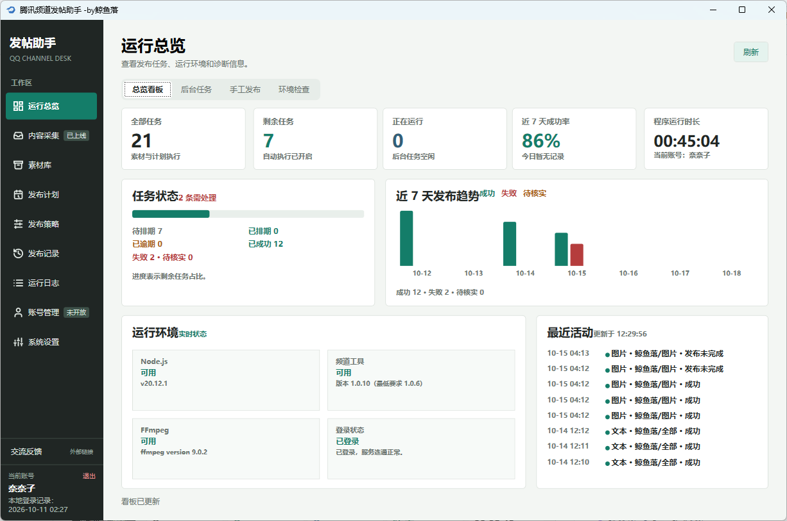

# QQ 频道发布台

QQ 频道发布台（`QqChannelDesk`）是一个面向 Windows 的 QQ 频道内容采集、素材管理和 Feed 发布工具。

它把环境检查、扫码授权、公开网页/TG 内容采集、素材整理、发布计划、发布策略和发布记录集中在一个 WPF 桌面应用中，并通过本机 Node.js 调用的官方 `tencent-channel-cli` 完成真实发布。业务数据默认保存在本机 SQLite 数据库，不依赖项目自建的远程业务服务。

> **安全提示**
>
> 发布操作会在真实 QQ 频道中创建内容。请只使用自己拥有或被授权管理的账号、频道和版块，并在发布前核对目标、标题、正文和媒体。
>
> 程序不能替代内容授权审核。转载、采集或发布第三方内容前，请自行确认版权、平台规则和账号权限。

## 项目地址

- Gitee：<https://gitee.com/vopipi/auto_push_qqpd>
- GitHub：<https://github.com/VoPiPi/auto_push_qqpd>
- 问题反馈：优先在对应仓库提交 Issue，并附上脱敏后的日志、复现步骤和版本号

## 主要能力

### 运行总览

- 查看素材供给、发布排期、自动化状态、发布质量和运行环境。
- 集中查看发布中的任务、最近活动和异常提醒。
- 在“手工发布”页签直接选择频道、版块和媒体发布内容。
- 在“环境检查”页签检测 Node.js、`tencent-channel-cli`、FFmpeg 和登录状态。
- 缺失环境可按界面提示安装或重新检测；FFmpeg 为可选组件，可按需在线安装。

### 账号与频道

- 使用 CLI 官方扫码流程完成登录授权。
- 登录后同步当前账号可访问的频道和版块。
- 二维码、授权链接、Token 等敏感信息不会写入程序日志或项目配置。
- “账号管理”页面当前仍为预留入口，暂时以单账号模式工作。

### 内容采集

内容采集页包含四个页签：

| 页签 | 用途 |
| --- | --- |
| 内容收件箱 | 从公开 HTTP/HTTPS 网页提取内容，进入收件箱后编辑标题、正文、标签和状态，确认后加入素材库 |
| TG 采集 | 临时读取公开 TG 频道预览页，支持关键词过滤、预览、删除和批量入库 |
| TG 定时采集 | 按 Cron 计划采集多个 TG 频道，并可按消息类型和关键词自动指定发布目标 |
| 代理池 | 同步、测活和验证公共 HTTP/HTTPS 代理节点，供 TG 网页采集使用 |

TG 采集支持网页代理自动选择和可编辑的自定义代理地址。内置代理入口包括 Proxy Unblocker、CoProxy 和 LumiProxy；代理站点可用性会受目标网站策略和网络环境影响，单次采集可能需要数十秒到数分钟。

采集与入库遵循以下边界：

- 普通网页采集和 TG 采集只面向公开页面，不支持读取用户 Cookie、绕过登录、验证码或反爬保护。
- TG 临时采集阶段只在内存中保存消息，不写入数据库，也不下载媒体。
- 只有执行“入库”时，TG 媒体才会下载并写入素材库。
- 媒体全部下载失败时不会创建空白素材；部分成功时保留成功媒体并提示失败数量。
- 采集到的公开内容是否可用于发布，由使用者自行确认授权和许可。

### TG 定时采集

- 每个配置维护频道地址、采集数量、网页代理、Cron 表达式、关键词和启用状态。
- Cron 使用 5 段格式：`分 时 日 月 周`，按运行电脑的本地时间计算。
- 支持 `*`、`*/n`、范围、列表和范围步长，例如 `0 2 * * *`、`*/15 * * * *`、`0 9 * * 1-5`。
- 关键词支持使用 `|` 分隔多个词，多个关键词按 OR 匹配；留空表示不过滤。
- 分发规则按“消息类型 + 关键词”匹配文本、图片或视频消息，第一条命中的规则生效。
- 未命中规则的消息仍可进入素材库，只保留空目标，等待后续人工处理。
- 可为命中的素材启用自动排期，实际发布时间继续受发布策略和每日额度限制。
- 定时任务需要主程序处于运行状态；TG 定时采集默认串行执行，避免同时产生过多外部请求。

### 素材库

- 管理文本、图片和视频素材，支持标题、正文、频道、版块、发布时间、来源和状态。
- 图文素材在标题/正文列中优先显示标题，其次显示正文，最后显示媒体摘要。
- 支持手工新增、批量导入、批量设置频道、批量设置发布时间、批量删除和批量发布。
- 支持 Excel 模板导入和导出，模板列结构保持稳定。
- 发布前会再次校验媒体文件和内容规则；失败发布不会删除原始素材。

当前发布规则：

- 有有效图片或视频时，标题和正文都可以为空。
- 没有有效媒体时，正文不能为空。
- 只有标题、没有正文和有效媒体的内容不能发布。
- 视频最多 1 个。
- 无标题短贴正文最多 1000 个字符。
- 有标题长贴正文最多 10000 个字符。
- 无标题短贴最多 18 张图片；有标题长贴最多 50 张图片。
- 图片和视频不能混合发布，媒体数量和文件有效性仍按现有规则校验。

### 发布计划与发布策略

- 素材设置发布时间后生成发布计划，可按计划自动执行。
- 支持立即检查、暂停、启动、删除计划，以及批量暂停、启动和删除。
- 支持配置每个版块的发布窗口、随机间隔、每日数量、并发和队列上限。
- 支持配置每个频道的每日自动发布总预算。
- 手工发布和计划发布复用同一套发布执行逻辑。
- 失败、超时或程序异常退出时不会自动重复发布；结果不明确时会提示核实真实频道状态。

### 发布记录与日志

- 发布记录按标题、正文和媒体摘要展示，并提供状态、目标、执行时间和帖子链接。
- 记录只保留执行所需的最少信息，不保存授权凭证或媒体完整路径。
- 运行日志支持筛选、自动滚动和导出，日志内容会对常见凭证字段进行脱敏。
- 系统异常会写入日志文件；排查问题时请先关闭或遮挡日志中的本地路径和业务信息，再提交 Issue。

### 系统设置

- 设置素材文件目录和 FFmpeg 路径。
- 设置计划任务自动执行、启动时运行任务、Windows 开机启动和托盘行为。
- 设置已发布任务文件的保留策略。
- 可选检查 Gitee Release 元数据；发现新版本时只显示提示并打开 Release 页面，不自动下载、安装或覆盖程序。

## 典型使用流程

1. 首次启动后进入“运行总览 -> 环境检查”，准备 Node.js、`tencent-channel-cli` 和可选的 FFmpeg。
2. 使用扫码授权登录，在频道同步区域获取账号可访问的频道和版块。
3. 在“内容采集”中选择一种来源：
   - 公开网页：提取到内容收件箱，审核后加入素材库。
   - TG 临时采集：确认消息后直接批量加入素材库。
   - TG 定时采集：按 Cron 自动采集，并根据规则写入素材目标。
4. 在“素材库”补全标题、正文、频道、版块和发布时间。
5. 立即发布，或等待“发布计划”自动执行。
6. 在“发布记录”和“运行日志”中查看结果；失败内容按日志提示处理后重新发布。

## 快速开始

### 方式一：使用 Release 包

1. 从 [GitHub Releases](https://github.com/VoPiPi/auto_push_qqpd/releases) 或 [Gitee Releases](https://gitee.com/vopipi/auto_push_qqpd/releases) 下载发布包。
2. 解压到一个可写的普通目录，建议不要放在 `Program Files` 等需要管理员权限的位置。
3. 双击 `QqChannelDesk.exe` 启动。
4. 进入“运行总览 -> 环境检查”，按页面提示完成 Node.js、CLI、FFmpeg 和登录检查。

Release 包为 `win-x64` 自包含单文件发布，已包含 .NET/WPF 运行时，不要求用户单独安装 .NET。首次运行会在程序目录创建数据库、日志和运行期目录。

### 方式二：从源码运行

准备以下环境：

- Windows 10 或更高版本
- [.NET 8 SDK](https://dotnet.microsoft.com/download/dotnet/8.0)
- Node.js
- `tencent-channel-cli`，最低版本 `1.0.6`
- Microsoft Edge WebView2 Runtime，通常随 Windows 自带；TG 网页代理采集需要它
- FFmpeg，仅在需要视频处理时由程序按需安装或手动指定

克隆并启动：

```powershell
git clone https://github.com/VoPiPi/auto_push_qqpd.git
cd auto_push_qqpd
dotnet restore
dotnet run --project .\src\QqChannelDesk\QqChannelDesk.csproj
```

如果使用 Gitee 镜像，可以把克隆地址替换为：

```powershell
git clone https://gitee.com/vopipi/auto_push_qqpd.git
```

仓库当前没有解决方案文件，请直接使用项目文件路径。

## 构建、测试与打包

在仓库根目录打开 PowerShell：

```powershell
# 还原依赖
dotnet restore

# Release 构建
dotnet build .\src\QqChannelDesk\QqChannelDesk.csproj -c Release

# 运行自动化测试
dotnet test .\tests\QqChannelDesk.Tests\QqChannelDesk.Tests.csproj -c Release

# 日常调试运行
dotnet run --project .\src\QqChannelDesk\QqChannelDesk.csproj
```

制作发布包：

```powershell
.\scripts\Build-UpdateZip.ps1 -Version 1.0.1
```

打包脚本使用 `win-x64`、自包含、单文件发布，并关闭 `PublishTrimmed`，避免 WPF 和 ClosedXML 等反射场景在裁剪后运行失败。发布包会排除数据库、会话和同步状态文件、日志、`temp`、媒体缓存及本地 FFmpeg 工具目录。FFmpeg 不随包分发，由用户在程序内按需安装。

上传发布资产时建议使用 `v主版本.次版本.修订版本` 标签，例如 `v1.0.1`。程序只读取公开 Release 元数据，不执行 Release 中的脚本。

## 数据、日志与本地目录

默认路径均相对于程序运行目录。实际位置可在“系统设置”中查看或调整。

| 路径 | 说明 |
| --- | --- |
| `channels.db` | 频道缓存、内容收件箱、素材、发布计划和发布记录等业务数据库 |
| `channels.sync.json` | 频道同步状态，不保存 Token 或 Cookie |
| `account.session.json` | 本地账号展示信息，不保存 CLI 授权凭证 |
| `logs/` | 按日期保存的运行日志 |
| `temp/` | 素材、发布任务和 TG 媒体暂存目录，可按保留策略清理 |
| `tools/media-cache/` | 公开媒体链接的本地缓存 |
| `tools/ffmpeg/bin/` | 按需安装的本地 FFmpeg 可执行文件 |
| `%LOCALAPPDATA%/QqChannelDesk/settings.json` | 部分本地界面兼容设置，具体设置以当前版本为准 |

TG 媒体入库时会暂存到类似以下目录：

```text
temp/telegram/yyyyMMdd/{频道}/
```

该目录只保存图片或视频文件，不生成 `message.txt`。发布任务会在 `temp/jobs/` 下建立独立副本；成功发布后按用户选择的保留策略清理，失败发布保留素材以便重试。

## 隐私与安全边界

本项目采用本地优先设计，但仍需注意以下边界：

- 不采集、不保存、不提交 Token、Cookie、授权链接、二维码内容或其他账号凭证。
- 日志、异常、测试输出和 Issue 附件必须脱敏。
- 公开网页采集只处理公开 HTTP/HTTPS 页面，不注入用户登录态，不绕过验证码或访问控制。
- 允许采集不等于允许转载或发布，请自行确认内容授权、平台规则和账号权限。
- 发布历史只保留标题、正文摘要、媒体摘要和结果链接，不保存媒体完整路径。
- 程序目录需要写入权限，否则可能无法创建数据库、日志、临时文件和素材。
- 只使用自己管理的测试频道进行首次验证；不要用未确认内容的真实频道做试发。

## 项目结构

```text
src/QqChannelDesk/
├── Pages/                  主窗口中的功能页面
│   ├── OperationsCenterPage.xaml
│   ├── ContentCollectionPage.xaml
│   ├── MaterialsPage.xaml
│   ├── PublishSchedulePage.xaml
│   ├── PublishPolicyPage.xaml
│   ├── HistoryPage.xaml
│   ├── LogPage.xaml
│   └── SettingPage.xaml
├── Services/               CLI、SQLite、采集、媒体、调度、日志和诊断服务
├── MainWindow.xaml(.cs)    导航和服务装配
├── App.xaml                全局 WPF 样式和资源
├── *Window.xaml            编辑、预览、登录和安装进度等弹窗
├── QqChannelDesk.csproj    WPF 项目文件
└── tools/                  运行期本地工具目录，不提交

tests/QqChannelDesk.Tests/  xUnit 自动化测试
docs/                       人工验证清单和方案文档
scripts/                    构建、发布和打包脚本
LICENSE                     项目许可证
```

## 开发约定

- UI 使用 C#、WPF 和 `net8.0-windows`，遵循现有 `App.xaml` 样式资源。
- 业务逻辑优先放在 `Services/`，页面 code-behind 负责界面状态、事件绑定和交互。
- 手工发布和计划发布必须继续复用现有发布执行路径，不要在页面中复制发布逻辑。
- 异步方法应接收并传递 `CancellationToken`，不要在后台任务中直接更新 WPF 控件。
- 文件路径使用 `Path.Combine`、`Path.GetFullPath` 和 `AppContext.BaseDirectory`。
- 外部进程使用 `ProcessStartInfo.ArgumentList`，并设置超时、取消和退出后的输出读取。
- 新业务表和新查询必须带账号作用域，兼容旧数据库时使用幂等迁移。
- 自动化测试不得调用真实 CLI、真实网络、真实 WebView2 登录或真实发布；使用临时数据库和可控替身。
- 新增 NuGet 依赖前先确认现有标准库或项目组件无法完成，并说明包体积、许可证和离线运行影响。

## 常见问题

### 启动后没有频道或版块

先确认登录状态正常，再执行频道同步。频道列表来自 CLI 返回的当前账号权限范围；没有权限的频道不会出现。

### 为什么采集成功，但素材库没有数据？

TG 临时采集阶段不会落库或下载媒体。需要在临时列表中确认并执行“入库”，媒体才会下载到素材库。TG 定时采集则会在完成媒体下载后写入素材库。

### 为什么视频功能不可用？

视频处理依赖 FFmpeg。进入“运行总览 -> 环境检查”安装 FFmpeg，或在“系统设置”中指定已有的 `ffmpeg.exe`。安装过程不会修改系统 PATH。

### 定时任务为什么没有执行？

计划任务和 TG 定时采集都依赖主程序运行。检查任务是否启用、Cron 是否有效、程序是否在运行，以及系统设置中的自动执行选项是否开启。

### TG 网页代理采集为什么偶尔失败？

公共代理站点本身会变更协议、限流或短时不可用；WebView2 和网络环境也会影响页面加载。程序会显示当前代理和错误原因，自动选择模式会按顺序尝试系统代理，用户可以改用其他代理或自定义代理地址。

### 发布失败后媒体还在吗？

发布失败不会自动删除素材或任务媒体，方便检查原因后重试。成功发布后是否清理由“已发布任务文件保留策略”决定。

### 更新按钮会自动安装新版吗？

不会。当前版本只检查公开 Release 元数据并提示用户，下载、替换和回滚由用户手动完成。

## 当前限制

- 当前以单账号流程为主，多账号管理页面尚未开放。
- 图片和视频不能混发，视频最多 1 个。
- 计划任务依赖程序持续运行，不是独立 Windows 服务。
- 公共代理和第三方网页结构可能随时变化，TG 采集成功率不作保证。
- 真实平台可能调整接口、权限或审核规则，最终结果以当前 CLI 和 QQ 频道平台反馈为准。
- 更新检查不自动安装，也不会在发布失败或超时时自动重试。

## 验证与贡献

提交代码前至少运行：

```powershell
dotnet build .\src\QqChannelDesk\QqChannelDesk.csproj -c Release
dotnet test .\tests\QqChannelDesk.Tests\QqChannelDesk.Tests.csproj -c Release
```

人工验证清单见 [`docs/manual-validation-checklist.md`](docs/manual-validation-checklist.md)，QQ 频道发布可行性和流程调研见 [`docs/qq-channel-publish-feasibility.md`](docs/qq-channel-publish-feasibility.md)。

欢迎提交 Bug、改进建议和 Pull Request。涉及发布、授权、频道同步或媒体删除的改动，请同时说明安全影响、账号隔离影响和手工验证方式。

## 许可证

本项目使用 [GNU General Public License v3.0](LICENSE)。

程序按需下载的 FFmpeg 构建可能有独立的许可证和再分发要求，使用或重新分发前请阅读对应项目的许可证说明。
