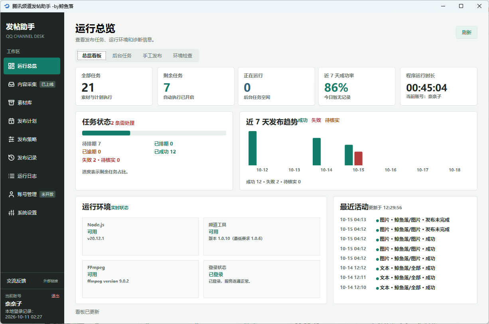

# QQ 频道发布台

QQ 频道发布台（`QqChannelDesk`）是一个面向 Windows 的 QQ 频道内容采集、素材管理和 Feed 发布工具。

它把环境检查、扫码授权、公开网页/TG 内容采集、素材整理和发布中心集中在一个 WPF 桌面应用中，并通过本机 Node.js 调用的官方 `tencent-channel-cli` 完成真实发布。业务数据默认保存在本机 SQLite 数据库，不依赖项目自建的远程业务服务。

> **安全提示**
>
> 发布操作会在真实 QQ 频道中创建内容。请只使用自己拥有或被授权管理的账号、频道和版块，并在发布前核对目标、标题、正文和媒体。
>
> 程序不能替代内容授权审核。转载、采集或发布第三方内容前，请自行确认版权、平台规则和账号权限。

## 项目地址

- Gitee：<https://gitee.com/vopipi/auto_push_qqpd>
- GitHub：<https://github.com/VoPiPi/auto_push_qqpd>
- 问题反馈：优先在对应仓库提交 Issue，并附上脱敏后的日志、复现步骤和版本号

## 主要能力

### 单实例与计划任务

- 同一 Windows 会话只运行一个程序实例；重复启动会唤醒并置前已有主窗口，包括已隐藏到托盘或最小化的窗口。
- 第二个进程会在数据库初始化和发布/TG 调度器创建之前退出，因此不会生成第二套计划执行循环。
- 主实例正常退出后可以重新启动；异常退出后 Mutex 由系统释放，不会留下需要手工清理的锁文件。

### 运行总览

- 查看素材供给、发布排期、自动化状态、发布质量和运行环境。
- 集中查看发布中的任务、最近活动和异常提醒。
- 在“手工发布”页签直接选择频道、版块和媒体发布内容。
- 在“环境检查”页签检测 Node.js、`tencent-channel-cli`、FFmpeg 和登录状态。
- 缺失环境可按界面提示安装或重新检测；FFmpeg 为可选组件，可按需在线安装。

### 账号与频道

- 使用 CLI 官方扫码流程完成登录授权。
- 登录后同步当前账号可访问的频道和版块。
- 二维码、授权链接、Token 等敏感信息不会写入程序日志或项目配置。
- “账号管理”页面当前仍为预留入口，暂时以单账号模式工作。

### 内容采集

内容采集页包含四个页签：

| 页签 | 用途 |
| --- | --- |
| 内容收件箱 | 从公开 HTTP/HTTPS 网页提取内容，进入收件箱后编辑标题、正文、标签和状态，确认后加入素材库 |
| TG 采集 | 临时读取公开 TG 频道预览页，支持包含词和排除词过滤（多个词用 `|` 分隔）、预览、删除和批量入库 |
| TG 定时采集 | 按 Cron 计划采集多个 TG 频道，并可按消息类型和关键词自动指定发布目标 |
| 代理池 | 同步、测活和验证公共 HTTP/HTTPS 代理节点，供 TG 采集的“代理池节点”通道使用 |

手工 TG 采集和 TG 定时采集都提供传输通道选择，可选项为“自动选择 / 系统代理 / 代理池节点 / 在线解析”。其中直连、系统代理和代理池节点都是标准 HTTP(S) 请求，只是改变连接方式；在线解析才通过内置网页代理进入页面。内置网页代理入口包括 Proxy Unblocker、CoProxy 和 LumiProxy，可用性会受目标网站策略和网络环境影响，单次采集可能需要数十秒到数分钟。

采集与入库遵循以下边界：

- 普通网页采集和 TG 采集只面向公开页面，不支持读取用户 Cookie、绕过登录、验证码或反爬保护。
- TG 临时采集阶段只在内存中保存消息，不写入数据库，也不下载媒体。
- 只有执行“入库”时，TG 媒体才会下载并写入素材库。
- TG 入库时，只要正文或至少一条媒体可用，就会创建素材并保留成功内容；失败媒体会在结果中提示，本次不自动排期，后续运行也不会自动补齐缺失媒体。只有全部媒体失败且没有标题正文时，才不创建素材。
- 采集到的公开内容是否可用于发布，由使用者自行确认授权和许可。

### TG 定时采集

- 每个配置维护频道地址、采集数量、传输通道、Cron 表达式、包含词、排除词和启用状态。
- Cron 使用 5 段格式：`分 时 日 月 周`，按运行电脑的本地时间计算。
- 支持 `*`、`*/n`、范围、列表和范围步长，例如 `0 2 * * *`、`*/10 * * * *`、`*/30 * * * *`、`0 9 * * 1-5`。
- 高级设置提供每 10 分钟、每 15 分钟、每 30 分钟、每 60 分钟、每天凌晨 2 点、工作日早上 9 点、每周一早上 9 点和每月 1 日早上 9 点等常用 Cron 预设，也可以切换为自定义表达式；10/30/60 分钟轮询还提供快捷按钮。
- 采集筛选分为包含词和排除词，均使用 `|` 分隔多个词。标题或正文命中任一包含词才保留，包含词留空表示不限制；命中任一排除词就丢弃，排除词留空表示不排除。两者同时命中时排除优先。
- 分发规则按“消息类型 + 关键词”匹配文本、图片或视频消息，第一条命中的规则生效。
- 未命中规则的消息仍可进入素材库，只保留空目标，等待后续人工处理。
- 可为命中的素材启用自动排期，实际发布时间继续受自动规则和每日额度限制。
- 首次运行会先按默认逻辑处理当前首页最新 20 条，再记录首页最高消息号作为安全水位；即使选择“先导入当前首页，之后仅采新消息”，也不会跳过首次首页内容。后续按水位只采集新消息。
- 单条消息处理失败不会中断同批次后续消息；失败消息会阻止安全水位越过它，后续消息仍会继续处理，避免失败内容因水位推进被永久跳过。
- 频道请求、网络等批次级失败会按 5、15、30、60、60、60、60 分钟的间隔自动重试；累计第 8 次失败后显示“失败（自动重试已停止）”，清空重试时间并停止常规 Cron 派发，之后可通过“立即采集”手工恢复。
- 每次只读取频道首页，不翻页；按发布时间从新到旧最多处理 20 条，并按消息链接去重。先截取首页最新 20 条，再执行水位、包含词和排除词筛选；筛选后不足 20 条也不会读取更早内容补足。运行中的配置再次触发“立即采集”时复用现有队列项，不会重复入队。
- 部分媒体成功时会保留成功媒体或正文，结果标为“部分成功”，本次不自动排期，后续运行也不会自动下载缺失媒体。
- 同一连续失败周期内，定时采集失败只发送一次托盘通知；成功或部分成功后才重置通知状态。
- 表格分别显示“最近尝试”和“最近成功”，避免一次失败覆盖上次成功时间。
- 定时任务需要主程序处于运行状态；TG 定时采集默认单任务执行，可在系统设置中调整为同时执行两个计划，并与发帖计划并发独立。其余任务按入队顺序等待。每行独立显示“执行中 / 排队 #序号”并提供“取消采集 / 取消排队”，不会因为单个任务锁定整页控件。
- 每个计划只保留最近 500 条采集记录，新增记录后自动清理更早历史；删除计划会同时删除该计划的采集历史。可通过每行的“历史”按计划、状态和关键词筛选，窗口最多显示最近 500 条；记录包含频道首页读取结果、安全水位、自动排期统计和脱敏错误摘要，并按账号隔离。

### 素材库

- 管理文本、图片和视频素材，支持标题、正文、频道、版块、发布时间、来源和状态。
- 图文素材在标题/正文列中优先显示标题，其次显示正文，最后显示媒体摘要。
- 支持手工新增、批量导入、批量设置频道、批量设置发布时间、批量删除和批量发布。
- 支持 Excel 模板导入和导出，模板列结构保持稳定。
- 发布前会再次校验媒体文件和内容规则；失败发布不会删除原始素材。

当前发布规则：

- 有有效图片或视频时，标题和正文都可以为空。
- 没有有效媒体时，正文不能为空。
- 只有标题、没有正文和有效媒体的内容不能发布。
- 视频最多 1 个。
- 无标题短贴正文最多 1000 个字符。
- 有标题长贴正文最多 10000 个字符。
- 无标题短贴最多 18 张图片；有标题长贴最多 50 张图片。
- 图片和视频不能混合发布，媒体数量和文件有效性仍按现有规则校验。

### 发布中心

- “发布中心”集中管理“计划队列”“自动规则”和“发布记录”三个页签。
- 素材设置发布时间后进入计划队列，可按计划自动执行，也支持立即检查、暂停、启动和删除。
- 自动规则约束采集入库后的自动排期，支持每个版块的发布窗口、随机间隔、每日数量、并发和队列上限。
- 支持配置每个频道的每日自动发布总预算。
- 手工计划优先且不受自动规则限制；手工发布和计划发布复用同一套发布执行逻辑。
- 停用或删除自动规则不会删除已生成的计划记录，但自动计划会暂停领取；恢复规则后才能继续执行。
- 失败、超时或程序异常退出时不会自动重复发布；结果不明确时会提示核实真实频道状态。

### 发布记录与日志

- “发布中心 -> 发布记录”按标题、正文和媒体摘要展示结果，并提供状态、目标、执行时间和帖子链接。
- 记录只保留执行所需的最少信息，不保存授权凭证或媒体完整路径。
- 运行日志支持筛选、自动滚动和导出，日志内容会对常见凭证字段进行脱敏。
- 系统异常会写入日志文件；排查问题时请先关闭或遮挡日志中的本地路径和业务信息，再提交 Issue。

### 系统设置

- 设置素材文件目录和 FFmpeg 路径。
- 设置计划任务自动执行、启动时运行任务、Windows 开机启动和托盘行为。
- 设置已发布任务文件的保留策略。
- 可选在启动后自动检查 Gitee 正式版 Release；发现新版本时只在侧栏显示紧凑提示，不阻塞当前页面，也不弹出模态框。
- 手动检查更新时会打开“版本更新”窗口，展示版本对比、发布时间、Windows 更新包、大小、SHA-256 和更新说明。
- 支持“稍后提醒”和“跳过此版本”；跳过状态按完整 Release Tag 保存，发布新 Tag 后会重新提示。

## 典型使用流程

1. 首次启动后进入“运行总览 -> 环境检查”，准备 Node.js、`tencent-channel-cli` 和可选的 FFmpeg。
2. 使用扫码授权登录，在频道同步区域获取账号可访问的频道和版块。
3. 在“内容采集”中选择一种来源：
   - 公开网页：提取到内容收件箱，审核后加入素材库。
   - TG 临时采集：确认消息后直接批量加入素材库。
   - TG 定时采集：按 Cron 自动采集，并根据规则写入素材目标。
4. 在“素材库”补全标题、正文、频道、版块和发布时间。
5. 立即发布，或等待“发布中心 -> 计划队列”自动执行。
6. 在“发布中心 -> 发布记录”和“运行日志”中查看结果；失败内容按日志提示处理后重新发布。

## 快速开始

### 方式一：使用 Release 包

1. 从 [Gitee Releases](https://gitee.com/vopipi/auto_push_qqpd/releases) 下载 `QqChannelDesk-{数字版本}-win-x64.zip`；如果发布方同时提供同名 `.sha256` 文件，请一并下载并核对。
2. 解压到一个可写的普通目录，建议不要放在 `Program Files` 等需要管理员权限的位置。
3. 双击 `QqChannelDesk.exe` 启动。
4. 进入“运行总览 -> 环境检查”，按页面提示完成 Node.js、CLI、FFmpeg 和登录检查。

Release 包为 `win-x64` 自包含单文件发布，已包含 .NET/WPF 运行时，不要求用户单独安装 .NET。首次运行会在程序目录创建数据库、日志和运行期目录。程序不会自动下载、替换或安装更新；升级时请先关闭程序，再手动解压覆盖原程序目录。数据库、日志、素材和本地工具不在更新包内，覆盖前仍建议按需备份本地数据。

### 方式二：从源码运行

准备以下环境：

- Windows 10 或更高版本
- [.NET 8 SDK](https://dotnet.microsoft.com/download/dotnet/8.0)
- Node.js
- `tencent-channel-cli`，最低版本 `1.0.6`
- Microsoft Edge WebView2 Runtime，通常随 Windows 自带；TG 的“在线解析”通道需要它
- FFmpeg，仅在需要视频处理时由程序按需安装或手动指定

克隆并启动：

```powershell
git clone https://github.com/VoPiPi/auto_push_qqpd.git
cd auto_push_qqpd
dotnet restore
dotnet run --project .\src\QqChannelDesk\QqChannelDesk.csproj
```

如果使用 Gitee 镜像，可以把克隆地址替换为：

```powershell
git clone https://gitee.com/vopipi/auto_push_qqpd.git
```

仓库当前没有解决方案文件，请直接使用项目文件路径。

## 构建、测试与打包

在仓库根目录打开 PowerShell：

```powershell
# 还原依赖
dotnet restore

# Release 构建
dotnet build .\src\QqChannelDesk\QqChannelDesk.csproj -c Release

# 运行自动化测试
dotnet test .\tests\QqChannelDesk.Tests\QqChannelDesk.Tests.csproj -c Release

# 日常调试运行
dotnet run --project .\src\QqChannelDesk\QqChannelDesk.csproj
```

制作发布包：

```powershell
.\scripts\Build-UpdateZip.ps1 -Version 1.0.1
```

打包脚本使用 `win-x64`、自包含、单文件发布，并关闭 `PublishTrimmed`，避免 WPF 和 ClosedXML 等反射场景在裁剪后运行失败。发布包会排除数据库、会话和同步状态文件、日志、`temp`、媒体缓存及本地 FFmpeg 工具目录。FFmpeg 不随包分发，由用户在程序内按需安装。

脚本在 ZIP 完整性和大小检查通过后，会在同目录生成 `QqChannelDesk-{Version}-win-x64.zip.sha256`，内容为标准的 `SHA256  文件名` 文本。若同名 ZIP 或 `.sha256` 已存在，脚本会在任何构建开始前停止，避免覆盖发布物。

上传发布资产时建议使用 `v主版本.次版本.修订版本` 标签，例如 `v1.0.1`，并同时上传 ZIP 与 `.sha256` 两个文件。程序只读取最多 10 条公开 Gitee Release 元数据，只比较数字版本最高的非预发布版本；不会下载应用 ZIP，也不会执行 Release 中的脚本。Release 页面和资产地址必须属于本仓库，带临时参数的跳转地址不会被展示或记录。

## 数据、日志与本地目录

默认路径均相对于程序运行目录。实际位置可在“系统设置”中查看或调整。

| 路径 | 说明 |
| --- | --- |
| `channels.db` | 频道缓存、内容收件箱、素材、发布计划和发布记录等业务数据库 |
| `channels.sync.json` | 频道同步状态，不保存 Token 或 Cookie |
| `account.session.json` | 本地账号展示信息，不保存 CLI 授权凭证 |
| `logs/` | 按日期保存的运行日志 |
| `temp/` | 素材、发布任务和 TG 媒体暂存目录，可按保留策略清理 |
| `tools/media-cache/` | 公开媒体链接的本地缓存 |
| `tools/ffmpeg/bin/` | 按需安装的本地 FFmpeg 可执行文件 |
| `%LOCALAPPDATA%/QqChannelDesk/settings.json` | 部分本地界面兼容设置，具体设置以当前版本为准 |

TG 媒体入库时会暂存到类似以下目录：

```text
temp/telegram/yyyyMMdd/{频道}/
```

该目录只保存图片或视频文件，不生成 `message.txt`。TG 媒体入库成功后会复制到素材库（默认 `temp/library/`），并删除暂存原件。发布任务会在素材存储目录的 `jobs/` 下建立独立副本；成功发布后按用户选择的保留策略清理任务副本，失败发布保留任务副本以便重试，素材库原件不会被发布流程删除。

## 隐私与安全边界

本项目采用本地优先设计，但仍需注意以下边界：

- 不采集、不保存、不提交 Token、Cookie、授权链接、二维码内容或其他账号凭证。
- 日志、异常、测试输出和 Issue 附件必须脱敏。
- 公开网页采集只处理公开 HTTP/HTTPS 页面，不注入用户登录态，不绕过验证码或访问控制。
- 允许采集不等于允许转载或发布，请自行确认内容授权、平台规则和账号权限。
- 发布历史只保留标题、正文摘要、媒体摘要和结果链接，不保存媒体完整路径。
- 程序目录需要写入权限，否则可能无法创建数据库、日志、临时文件和素材。
- 只使用自己管理的测试频道进行首次验证；不要用未确认内容的真实频道做试发。

## 项目结构

```text
src/QqChannelDesk/
├── Pages/                  主窗口中的功能页面
│   ├── OperationsCenterPage.xaml
│   ├── ContentCollectionPage.xaml
│   ├── MaterialsPage.xaml
│   ├── PublishSchedulePage.xaml
│   ├── PublishPolicyPage.xaml
│   ├── HistoryPage.xaml
│   ├── LogPage.xaml
│   └── SettingPage.xaml
├── Services/               CLI、SQLite、采集、媒体、调度、日志和诊断服务
├── MainWindow.xaml(.cs)    导航和服务装配
├── App.xaml                全局 WPF 样式和资源
├── *Window.xaml            编辑、预览、登录和安装进度等弹窗
├── QqChannelDesk.csproj    WPF 项目文件
└── tools/                  运行期本地工具目录，不提交

tests/QqChannelDesk.Tests/  xUnit 自动化测试
docs/                       人工验证清单和方案文档
scripts/                    构建、发布和打包脚本
LICENSE                     项目许可证
```

## 开发约定

- UI 使用 C#、WPF 和 `net8.0-windows`，遵循现有 `App.xaml` 样式资源。
- 业务逻辑优先放在 `Services/`，页面 code-behind 负责界面状态、事件绑定和交互。
- 手工发布和计划发布必须继续复用现有发布执行路径，不要在页面中复制发布逻辑。
- 异步方法应接收并传递 `CancellationToken`，不要在后台任务中直接更新 WPF 控件。
- 文件路径使用 `Path.Combine`、`Path.GetFullPath` 和 `AppContext.BaseDirectory`。
- 外部进程使用 `ProcessStartInfo.ArgumentList`，并设置超时、取消和退出后的输出读取。
- 新业务表和新查询必须带账号作用域，兼容旧数据库时使用幂等迁移。
- 自动化测试不得调用真实 CLI、真实网络、真实 WebView2 登录或真实发布；使用临时数据库和可控替身。
- 新增 NuGet 依赖前先确认现有标准库或项目组件无法完成，并说明包体积、许可证和离线运行影响。

## 常见问题

### 启动后没有频道或版块

先确认登录状态正常，再执行频道同步。频道列表来自 CLI 返回的当前账号权限范围；没有权限的频道不会出现。

### 为什么采集成功，但素材库没有数据？

TG 临时采集阶段不会落库或下载媒体。需要在临时列表中确认并执行“入库”，媒体才会下载到素材库。TG 定时采集则会在完成媒体下载后写入素材库。

### 为什么视频功能不可用？

视频处理依赖 FFmpeg。进入“运行总览 -> 环境检查”安装 FFmpeg，或在“系统设置”中指定已有的 `ffmpeg.exe`。安装过程不会修改系统 PATH。

### 定时任务为什么没有执行？

计划任务和 TG 定时采集都依赖主程序运行。检查任务是否启用、Cron 是否有效、程序是否在运行，以及系统设置中的自动执行选项是否开启。

### TG 采集为什么偶尔失败？

TG 采集可能受网络环境、公共代理站点和 WebView2 影响：直连和系统代理依赖本机网络，公共代理站点本身会变更协议、限流或短时不可用，“在线解析”还依赖 WebView2 加载页面。程序会显示当前通道和各通道的失败原因；“自动选择”会按“直连 → 系统代理 → 代理池节点 → 在线解析”顺序回退，显式选中某个通道后失败不再自动回退，可以改用其他通道后重试。

### 发布失败后媒体还在吗？

发布失败不会自动删除素材或任务媒体，方便检查原因后重试。成功发布后是否清理由“已发布任务文件保留策略”决定。

### 更新按钮会自动安装新版吗？

不会。当前版本只检查公开 Gitee Release 元数据，忽略预发布版本，并在详情窗口展示更新包名称、大小和校验值。下载、关闭程序、解压覆盖、安装和回滚均由用户手动完成；程序不会替换自身文件。

## 当前限制

- 当前以单账号流程为主，多账号管理页面尚未开放。
- 图片和视频不能混发，视频最多 1 个。
- 计划任务依赖程序持续运行，不是独立 Windows 服务。
- 公共代理和第三方网页结构可能随时变化，TG 采集成功率不作保证。
- 真实平台可能调整接口、权限或审核规则，最终结果以当前 CLI 和 QQ 频道平台反馈为准。
- 更新检查不自动安装，也不会在发布失败或超时时自动重试。

## 验证与贡献

提交代码前至少运行：

```powershell
dotnet build .\src\QqChannelDesk\QqChannelDesk.csproj -c Release
dotnet test .\tests\QqChannelDesk.Tests\QqChannelDesk.Tests.csproj -c Release
```

人工验证清单见 [`docs/manual-validation-checklist.md`](docs/manual-validation-checklist.md)，QQ 频道发布可行性和流程调研见 [`docs/qq-channel-publish-feasibility.md`](docs/qq-channel-publish-feasibility.md)。

欢迎提交 Bug、改进建议和 Pull Request。涉及发布、授权、频道同步或媒体删除的改动，请同时说明安全影响、账号隔离影响和手工验证方式。

## 许可证

本项目使用 [GNU General Public License v3.0](LICENSE)。

程序按需下载的 FFmpeg 构建可能有独立的许可证和再分发要求，使用或重新分发前请阅读对应项目的许可证说明。
